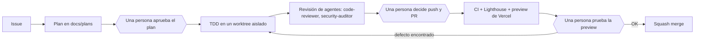

# Diego Estela · Portfolio, construido con un equipo de ingeniería con IA

[English](README.md) · **Español**

[](https://github.com/DiegoEstela/diego-estela-portfolio/actions/workflows/ci.yml)


> Un sitio personal que es también un ejemplo real de **cómo construyo software con agentes de IA sin renunciar a la disciplina de ingeniería**: cada cambio pasa por una issue, un plan aprobado, una implementación con tests primero, la revisión de un agente y la decisión de una persona.

**Sitio en producción:** https://diego-estela-lopez.vercel.app · **Contacto:** die.estela@gmail.com

<p align="center">
  
</p>

<p align="center"><sub>El equipo de IA de este repositorio, dibujado con código. En el sitio, el botón del Hero <b>«Mi mundo IA»</b> lo abre, junto a mis proyectos con IA, y al tocar un personaje se ve su definición real. El bucle: el equipo trabaja mientras se llena la pizarra del plan y después descansa en el sofá.</sub></p>

## Qué demuestra este repositorio

1. **Ingeniería asistida por IA, con control.** Un orquestador y cuatro agentes especializados planifican, implementan y revisan el trabajo. No pueden hacer push, abrir un PR ni fusionar por su cuenta: son decisiones humanas, que se hacen cumplir con hooks y permisos y no con buenas intenciones.
2. **Rigor comprobable.** Desarrollo con tests primero, un CI que bloquea regresiones y secretos filtrados, y un rastro escrito de cada decisión (planes y ADR). Todo lo de abajo enlaza a la evidencia real.
3. **Un producto real.** Un portfolio bilingüe, responsive y accesible, con un chatbot en el servidor sobre la API de Anthropic.

## Conoce al equipo

Los personajes pixel art no son decoración. Cada uno es un agente definido en [`.claude/agents/`](.claude/agents), y el sitio lee esos ficheros al compilar, así que lo que ves es lo que el repositorio configura de verdad ([ADR 0005](docs/decisions/0005-oficina-de-agentes-pixel-art-con-codigo.md)).

La oficina también lee los planes del propio repositorio. La pizarra de la pared abre el último plan de [`docs/plans`](docs/plans) con su progreso real, y cuando todas las tareas están hechas el equipo se va a descansar al sofá. Un conmutador permite a quien visita cambiarlo ([ADR 0006](docs/decisions/0006-oficina-de-agentes-v2.md)).

| Personaje | Agente | Modelo | Qué hace | ¿Puede editar ficheros? |
| --------- | ------ | ------ | -------- | ----------------------- |
| Antena, camiseta naranja | Claude (orquestador) | — | Lee la issue, escribe el plan, implementa con TDD y pide la revisión a los demás. Es la propia sesión de Claude Code, no un fichero. | Sí, dentro de un worktree aislado |
| Gafas, camiseta azul | `code-reviewer` | `sonnet` | Revisa el diff antes del PR: corrección, tipos, hooks, legibilidad. | No, solo lee |
| Boina, camiseta rosa | `content-copywriter` | `sonnet` | Mejora los textos en español e inglés sin inventar logros. | Sí, solo texto |
| Visera, camiseta verde | `web-quality-auditor` | `sonnet` | Audita accesibilidad, SEO y tamaño del bundle. | No, solo lee |
| Insignia, camiseta morada | `security-auditor` | `sonnet` | Busca secretos, fugas al bundle público y dependencias vulnerables. | No, solo lee |

## Cómo viaja un cambio



Los rombos son **puntos de control humanos**; la IA no cruza ninguno por su cuenta.

| Capa | Mecanismo |
| ---- | --------- |
| Edición | Un hook ejecuta ESLint sobre cada fichero que edita la IA |
| Ejecución | Un hook bloquea `git add -A`, `--no-verify`, `--amend`, force push y escrituras en `.env*` (el hook tiene sus propios tests) |
| Permisos | Reglas `allow` y `deny` en `.claude/settings.json` |
| Commit | Husky, lint-staged y commitlint (Conventional Commits) |
| Pull request | CI (lint, tipos, tests, build, escaneo de secretos del bundle), Lighthouse, una revisión de IA y una plantilla de PR que declara qué hizo la IA y qué verificó una persona |
| Entrada no confiable | Las skills tratan el texto de issues y comentarios como datos, no como instrucciones |

Diagrama completo, principios y límites conocidos: **[docs/AI-WORKFLOW.md](docs/AI-WORKFLOW.md)**.

## Evidencias, no afirmaciones

- **Una persona vio lo que los tests no veían** ([issue #11](https://github.com/DiegoEstela/diego-estela-portfolio/issues/11), [PR #17](https://github.com/DiegoEstela/diego-estela-portfolio/pull/17)). Todos los checks estaban en verde, pero la prueba manual en la preview mostró que los mensajes de error no se traducían al cambiar de idioma. Se añadieron dos tareas al plan, primero un test que fallaba y después el arreglo ([ADR 0002](docs/decisions/0002-claves-i18n-en-mensajes-del-sistema.md)).
- **La revisión cambió el plan** ([PR #20](https://github.com/DiegoEstela/diego-estela-portfolio/pull/20)). La clave de Anthropic viajaba en el bundle público. Mover la llamada a una función serverless empezó como un plan de 10 tareas; los agentes revisores y una preview fallida lo ampliaron a 17, y [el plan](docs/plans/10-fix-protect-anthropic-key.md) registra cada añadido y su motivo. Ahora una guardia en CI rompe el build si una clave llega a `dist/`.
- **Verde en local no es verde en producción** ([PR #25](https://github.com/DiegoEstela/diego-estela-portfolio/pull/25)). El log de Vercel mostró dos errores del compilador que nunca aparecían en local: Vercel compila sin `strict` y despliega como función cada fichero de `api/`. El arreglo empezó con un test que reproduce la compilación de Vercel (rojo primero); los hallazgos del agente revisor se corrigieron en un commit posterior antes de fusionar.
- **Cada decisión está por escrito:** [`docs/decisions`](docs/decisions/README.md) (ADR) y [`docs/plans`](docs/plans) (un plan por cambio).

<details>
<summary><b>Detalles técnicos</b>: stack, comandos, estructura y seguridad del chatbot</summary>

### Stack

| Capa | Tecnología |
| ---- | ---------- |
| UI | React 19, TypeScript 6, Tailwind CSS 4, framer-motion |
| Build | Vite 8 |
| i18n | i18next, react-i18next (español e inglés; un test mantiene las claves sincronizadas) |
| Tests | Vitest, Testing Library, jsdom |
| Calidad | ESLint 9, Husky, lint-staged, commitlint |
| CI/CD | GitHub Actions, Lighthouse CI, Vercel (preview por PR) |
| IA | Claude Code (skills, agentes, hooks, servidor MCP context7) |

### Empezar

Requisitos: Node 22 o superior.

```bash
npm ci
npm run dev
```

| Comando | Para qué |
| ------- | -------- |
| `npm run dev` | Servidor de desarrollo |
| `npm run lint` | ESLint |
| `npm run typecheck` | Comprobación de tipos |
| `npm run test` | Tests (`test:watch`, `test:coverage`) |
| `npm run build` | Build de producción |
| `npm run check:bundle` | Falla si `dist/` contiene claves o el prompt del servidor |
| `npm run docs:office` | Regenera la animación de la cabecera de este README |

Para probar el chatbot en local, crea `.env.local` con `ANTHROPIC_API_KEY` (ver `.env.example`). Solo la lee el servidor, y `npm run dev` sirve `/api/chat` con el mismo handler que Vercel. La clave debe crearse con alcance de **workspace** en la consola de Anthropic. **No arranques el servidor con `--host` mientras haya una clave real**: expondría el endpoint, y tu crédito, a tu red local.

### Estructura

```
src/
  components/   Secciones y UI, incluida la oficina de agentes
  context/      Contextos de React (tema, chat)
  data/         Contenido del portfolio
  hooks/        Hooks propios
  locales/      Traducciones es y en
api/            Función serverless del chatbot (Vercel); aquí solo viven funciones
server/         Lógica del chatbot: validación, límites, adaptador del proveedor
vite-plugins/   Plugin que sirve /api/chat en desarrollo
.claude/        Skills, agentes, hooks y permisos de Claude Code
.github/        Workflows, plantillas de issue y de PR, Dependabot
docs/           Flujo de IA, planes y decisiones (ADR)
```

### Seguridad del chatbot

- La clave de Anthropic y el prompt del sistema nunca llegan al navegador: el cliente solo habla con `/api/chat` ([ADR 0004](docs/decisions/0004-api-del-chatbot-en-el-servidor.md)).
- El servidor valida la entrada, limita el tamaño de la conversación y el ritmo de peticiones, y oculta los errores del proveedor.
- El CI falla si el bundle contiene una clave (`npm run check:bundle`).
- Un límite honesto: el control de ritmo está en memoria por instancia, así que no es global. El tope real de gasto es el límite mensual configurado en la consola de Anthropic.

</details>

## Licencia y seguridad

Todos los derechos reservados: el código es público para leerlo y evaluarlo, no para reutilizarlo (véase [LICENSE](LICENSE)). Para reportar una vulnerabilidad, sigue [SECURITY.md](SECURITY.md).

## Contacto

Diego Estela · die.estela@gmail.com
