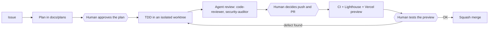

# Diego Estela · Portfolio, built with an AI engineering team

**English** · [Español](README.es.md)

[](https://github.com/DiegoEstela/diego-estela-portfolio/actions/workflows/ci.yml)


> A personal site that is also a working example of **how I build software with AI agents without giving up engineering discipline**: every change goes through an issue, an approved plan, test-first implementation, an agent review and a human decision.

**Live site:** https://diego-estela-lopez.vercel.app · **Contact:** die.estela@gmail.com

<p align="center">
  
</p>

<p align="center"><sub>The AI team of this repository, drawn from code. On the site, the Hero button <b>“My AI world”</b> opens it, next to my AI projects, and tapping a character shows its real definition. The loop: the team works while the plan board fills, then rests on the sofa.</sub></p>

## What this repository demonstrates

1. **AI-assisted engineering with control.** An orchestrator and four specialised agents plan, implement and review the work. They cannot push, open a PR or merge on their own: those are human decisions, enforced by hooks and permissions rather than by good intentions.
2. **Rigour you can check.** Test-first development, a CI that blocks regressions and leaked secrets, and a written trail for every decision (plans and ADRs). Everything below links to the real evidence.
3. **A real product.** A bilingual, responsive, accessible portfolio with a server-side chatbot on the Anthropic API.

## Meet the team

The pixel art characters are not decoration. Each one is an agent defined in [`.claude/agents/`](.claude/agents), and the site reads those files at build time, so what you see is what the repository really configures ([ADR 0005](docs/decisions/0005-oficina-de-agentes-pixel-art-con-codigo.md)).

The office also reads the repository's own plans. The board on the wall opens the latest plan in [`docs/plans`](docs/plans) with its real progress, and when every task is done the team goes to rest on the sofa. A toggle lets a visitor override that ([ADR 0006](docs/decisions/0006-oficina-de-agentes-v2.md)).

| Character | Agent | Model | What it does | Can it edit files? |
| --------- | ----- | ----- | ------------ | ------------------ |
| Antenna, orange shirt | Claude (orchestrator) | — | Reads the issue, writes the plan, implements with TDD and asks the others for a review. It is the Claude Code session itself, not a file. | Yes, inside an isolated worktree |
| Glasses, blue shirt | `code-reviewer` | `sonnet` | Reviews the diff before the PR: correctness, types, hooks, readability. | No, read-only |
| Beret, pink shirt | `content-copywriter` | `sonnet` | Improves the Spanish and English copy without inventing achievements. | Yes, text only |
| Visor, green shirt | `web-quality-auditor` | `sonnet` | Audits accessibility, SEO and bundle size. | No, read-only |
| Badge, purple shirt | `security-auditor` | `sonnet` | Hunts for secrets, leaks into the public bundle and vulnerable dependencies. | No, read-only |

## How a change travels



The diamonds are **human checkpoints**; the AI never crosses one by itself.

| Layer | Mechanism |
| ----- | --------- |
| Editing | A hook runs ESLint on every file the AI edits |
| Execution | A hook blocks `git add -A`, `--no-verify`, `--amend`, force push and writes to `.env*` (the hook has its own tests) |
| Permissions | `allow` and `deny` rules in `.claude/settings.json` |
| Commit | Husky, lint-staged and commitlint (Conventional Commits) |
| Pull request | CI (lint, types, tests, build, bundle secret scan), Lighthouse, an AI review, and a PR template that declares what the AI did and what a person verified |
| Untrusted input | Skills treat issue and comment text as data, not instructions |

Full diagram, principles and known limits: **[docs/AI-WORKFLOW.md](docs/AI-WORKFLOW.md)** (in Spanish).

## Evidence, not claims

- **A human caught what the tests could not** ([issue #11](https://github.com/DiegoEstela/diego-estela-portfolio/issues/11), [PR #17](https://github.com/DiegoEstela/diego-estela-portfolio/pull/17)). All checks were green, but testing the preview by hand showed error messages that did not translate when switching language. Two tasks were added to the plan, a failing test came first, then the fix ([ADR 0002](docs/decisions/0002-claves-i18n-en-mensajes-del-sistema.md)).
- **Review changed the plan** ([PR #20](https://github.com/DiegoEstela/diego-estela-portfolio/pull/20)). The Anthropic key used to ship in the public bundle. Moving the call to a serverless function started as a 10-task plan; the reviewer agents and a failed preview grew it to 17, and [the plan](docs/plans/10-fix-protect-anthropic-key.md) records each addition and why. A CI guard now fails the build if a key reaches `dist/`.
- **Local green is not production green** ([PR #25](https://github.com/DiegoEstela/diego-estela-portfolio/pull/25)). A Vercel build log showed two compiler errors that never appeared locally: Vercel compiles without `strict` and deploys every file in `api/` as a function. The fix started with a test that reproduces Vercel's compilation (red first); the reviewer agent's findings were fixed in a follow-up commit before merging.
- **Every decision is written down:** [`docs/decisions`](docs/decisions/README.md) (ADRs) and [`docs/plans`](docs/plans) (one plan per change).

<details>
<summary><b>Technical details</b>: stack, commands, structure and chatbot security</summary>

### Stack

| Layer | Technology |
| ----- | ---------- |
| UI | React 19, TypeScript 6, Tailwind CSS 4, framer-motion |
| Build | Vite 8 |
| i18n | i18next, react-i18next (Spanish and English, a test keeps the keys in sync) |
| Tests | Vitest, Testing Library, jsdom |
| Quality | ESLint 9, Husky, lint-staged, commitlint |
| CI/CD | GitHub Actions, Lighthouse CI, Vercel (a preview per PR) |
| AI | Claude Code (skills, agents, hooks, the context7 MCP server) |

### Getting started

Requires Node 22 or higher.

```bash
npm ci
npm run dev
```

| Command | Purpose |
| ------- | ------- |
| `npm run dev` | Development server |
| `npm run lint` | ESLint |
| `npm run typecheck` | Type check |
| `npm run test` | Tests (`test:watch`, `test:coverage`) |
| `npm run build` | Production build |
| `npm run check:bundle` | Fails if `dist/` contains keys or the server prompt |
| `npm run docs:office` | Regenerates the animation at the top of this README |

To try the chatbot locally, create `.env.local` with `ANTHROPIC_API_KEY` (see `.env.example`). Only the server reads it, and `npm run dev` serves `/api/chat` with the same handler as Vercel. The key must be created with a **workspace** scope in the Anthropic console. **Do not start the server with `--host` while a real key is present**: it would expose the endpoint, and your credit, to your local network.

### Structure

```
src/
  components/   Sections and UI, including the agents office
  context/      React contexts (theme, chat)
  data/         Portfolio content
  hooks/        Custom hooks
  locales/      Spanish and English translations
api/            Vercel serverless function for the chatbot (only functions live here)
server/         Chatbot logic: validation, rate limits, provider adapter
vite-plugins/   Plugin that serves /api/chat in development
.claude/        Skills, agents, hooks and permissions for Claude Code
.github/        Workflows, issue and PR templates, Dependabot
docs/           AI workflow, plans and decisions (ADRs)
```

### Chatbot security

- The Anthropic key and the system prompt never reach the browser: the client only talks to `/api/chat` ([ADR 0004](docs/decisions/0004-api-del-chatbot-en-el-servidor.md)).
- The server validates input, caps conversation size and request rate, and hides provider errors.
- CI fails if the bundle contains a key (`npm run check:bundle`).
- An honest limit: the rate limiter lives in memory per instance, so it is not global. The real spending cap is the monthly limit set in the Anthropic console.

</details>

## License and security

All rights reserved: the code is public to be read and evaluated, not to be reused (see [LICENSE](LICENSE)). To report a vulnerability, follow [SECURITY.md](SECURITY.md).

## Contact

Diego Estela · die.estela@gmail.com
